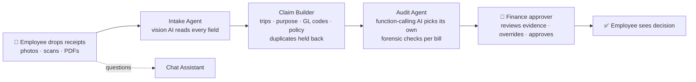

# ClaimPilot – Expense & Reimbursement Agent

**Track 1 · Expense & Reimbursement Agent**

From a pile of receipts to an approval-ready claim in under a minute, with zero typing. AI agents read every bill, build the claim, catch duplicates and fraud, and a human finance approver makes the final call.

| | |
|---|---|
| 📄 **Technical design document** | [docs/TECHNICAL_DESIGN.md](docs/TECHNICAL_DESIGN.md): overview, architecture & flow diagrams, setup/deployment, code explanation, assumptions |
| 🎬 **Demo video** | [▶ Watch the Expense Reimbursement Agent Demo on YouTube](https://youtu.be/SeJmQDqcWeM) |
| ✅ **Tests** | 92 unit + integration tests, 93% line coverage (`npm test`) |

> **Data & compliance:** every receipt, vendor, person, GSTIN and policy in this repository is **synthetic** (generated by `scripts/make_samples.py`). No company, employee, customer or personal data, and no credentials, are included. API keys live only in a git-ignored `.env`.

---

## The problem

Employees spend 3–6 minutes per receipt typing details, picking categories and guessing the policy. Claims bounce back. Finance re-checks every line by hand, and edited bills and double claims still slip through.

## The solution: four AI agents and one human



- **Employee portal** (`/employee`), in Web or Chat mode. Drop receipts and watch the agents work live. Duplicate tickets are shown with a side-by-side comparison and are never sent to finance. You can also ask the Chat Assistant anything about your claim.
- **Finance portal** (`/finance`). An approval queue that refreshes automatically. Each bill comes with an AI recommendation, a risk level, the agent's reasoning, an authenticity score and the receipt image. You can override any bill. Only a human can approve money.

### What the agents catch

| Check | Example from the demo set |
|---|---|
| Edited amount (arithmetic) | Fuel bill: items ₹3,387, printed total ₹5,387 |
| Fake GSTIN (checksum + registry) | Fuel bill: wrong check digit |
| Photo editing (EXIF / PDF metadata) | Fuel bill: saved by Adobe Photoshop |
| Exact duplicate | Same taxi receipt photographed twice: held back, shown to employee only |
| Already claimed | Coffee bill paid in an earlier claim: held back |
| Near match (kept, not removed) | Same restaurant/day/amount but a different time, bill no. and menu: flagged 🔍 for the approver |
| Policy | Hotel over the ₹6,000 metro cap (−₹2,800), alcohol at a client dinner (−₹600), missing date |

**Duplicate rule:** a receipt is held back only if it's the same file, or vendor, date, time, bill no., currency, total, tax **and every line item with its cost** are identical.

### Live AI and Offline AI

- **Live AI:** Google Gemini (default) or Anthropic Claude. Vision and PDF extraction use JSON-schema output; the Audit Agent and chat use function calling. A model pool routes around free-tier rate limits.
- **Offline AI:** used when there's no key or the network is down. Tesseract neural OCR, a receipt parser and a rule-based audit agent with the same tools, so the demo always works.

---

## Quick start

Requires **Node.js 20+**.

```bash
git clone <your-repo-url>
cd Expense-Reimbursement-Agent
npm install
cp .env.example .env        # Windows: copy .env.example .env
npm start
```

- In `.env`, set `GEMINI_API_KEY=...` (free at https://aistudio.google.com/apikey), or leave it empty for Offline AI.
- Open the URL the terminal prints (default http://localhost:3000; it moves to the next free port if busy).
- Pick **Employee** or **Finance**. For the demo, open both portals side by side and click **✨ Try 9 sample receipts**.

| Command | Purpose |
|---|---|
| `npm start` | Start the app |
| `npm test` | 92 tests, offline, ~10 s |
| `npm run coverage` | Tests with a coverage report |
| `npm run eval` | Extraction accuracy vs ground truth (`npm run eval -- --offline` for OCR only) |
| `npm run samples` | Regenerate synthetic receipts (Python + Pillow) |

## Tech stack

Node.js · Express · Server-Sent Events · Google Gemini (`@google/genai`) · Anthropic Claude (`@anthropic-ai/sdk`) · Zod JSON schemas · Tesseract.js · unpdf · vanilla HTML/CSS/JS · `node:test`

## Project structure

```
src/        server, Express app, agents (intake, audit, chat), claim engine, forensics, policy, mock finance
public/     sign-in page, employee portal, finance portal
samples/    9 synthetic receipts + ground truth
test/       unit + integration tests
docs/       technical design document, demo script
scripts/    sample generator, accuracy evaluation
```

See **[docs/TECHNICAL_DESIGN.md](docs/TECHNICAL_DESIGN.md)** for the full design.
