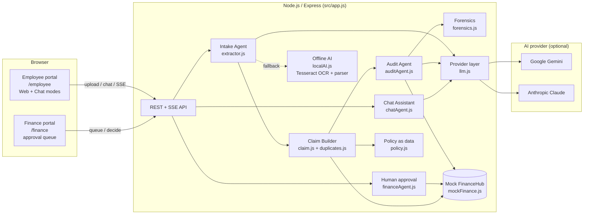
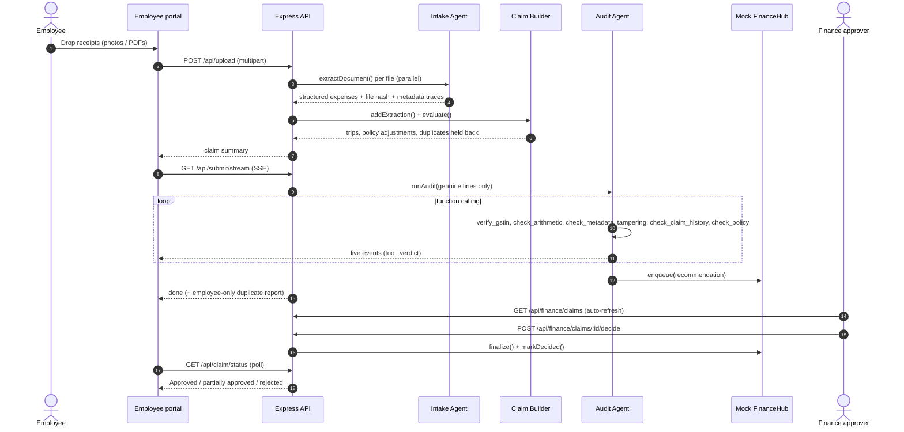
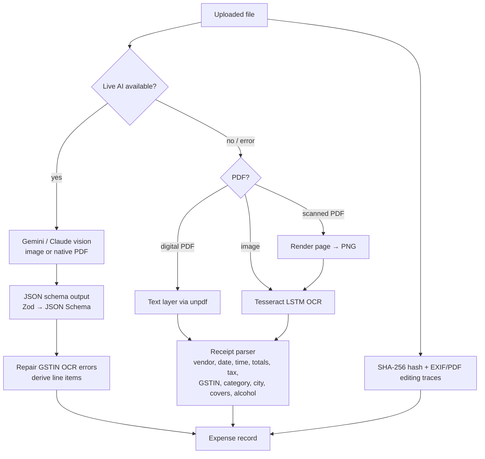
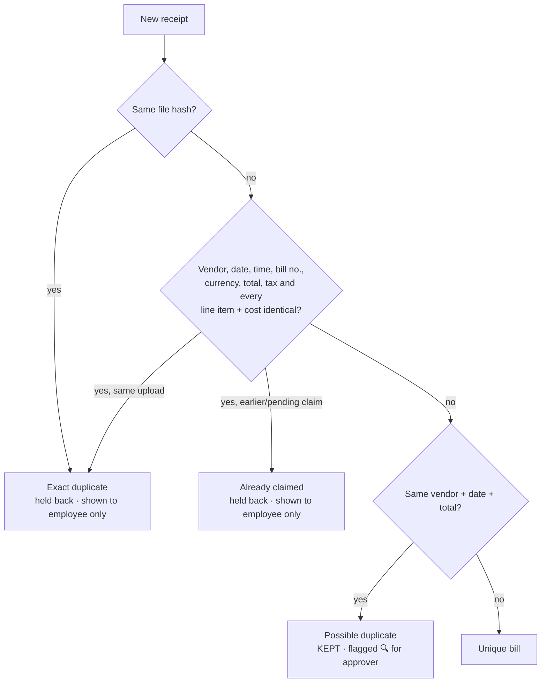
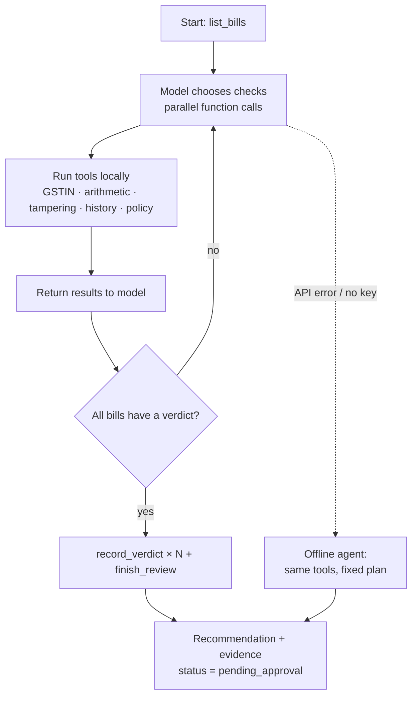
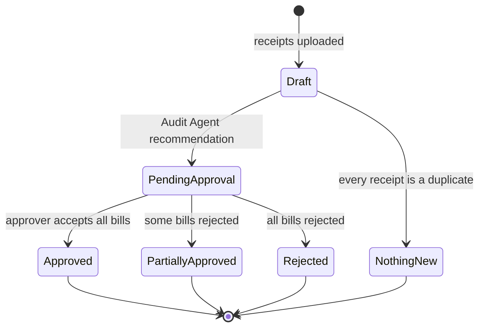
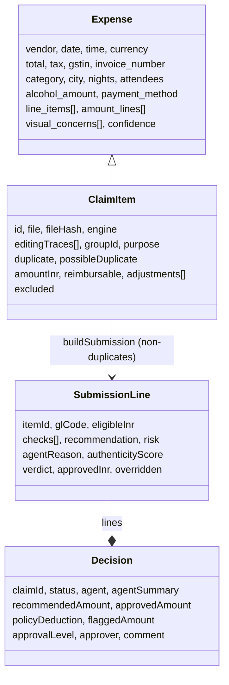

# ClaimPilot – Technical Design Document

**Track:** 1. Expense & Reimbursement Agent
**Project:** ClaimPilot, a multi-agent AI system that turns a pile of receipts into a verified, approval-ready reimbursement claim.
**Data:** all receipts, vendors, people, GSTINs and policies in this repository are **synthetic** (generated by `scripts/make_samples.py`). No company, employee, customer or personal data is used. No credentials are committed (`.env` is git-ignored).

---

## Contents

1. [Project overview](#1-project-overview)
2. [System architecture](#2-system-architecture)
3. [Flow diagrams](#3-flow-diagrams)
4. [Component and code explanation](#4-component-and-code-explanation)
5. [AI design](#5-ai-design)
6. [Data model](#6-data-model)
7. [API reference](#7-api-reference)
8. [Setup and deployment](#8-setup-and-deployment)
9. [Testing and reliability](#9-testing-and-reliability)
10. [Assumptions and limitations](#10-assumptions-and-limitations)
11. [Business impact](#11-business-impact)

---

## 1. Project overview

### 1.1 Problem

Filing an expense claim is manual, slow and error-prone for both sides:

| Who | Today | Pain |
|---|---|---|
| Employee | Collects bills, types vendor/date/amount/tax for each one, picks categories, guesses the policy, writes a purpose | 3–6 minutes per receipt; claims bounce back for policy or missing details |
| Finance | Re-checks every line by hand: arithmetic, GSTIN, duplicates, policy caps | Slow, and edited bills and double claims still slip through |

### 1.2 Solution

ClaimPilot covers the whole journey, from receipts to a decision:

- **The employee drops receipts and types nothing.** Photos, scans and PDFs are all accepted, in Web or Chat mode.
- **AI agents do the claim work:**
  - read every bill
  - group bills into trips
  - fill in purpose, category and GL code
  - apply the policy
  - catch duplicates
  - check every bill for authenticity
- **Duplicates are held back.** The employee sees them with a side-by-side comparison. They are never sent to finance.
- **Finance gets a pre-investigated claim.** Every bill comes with evidence and an AI recommendation.
- **A human approver makes the final decision.** The AI never pays anyone.

### 1.3 How the challenge is met

| Challenge statement | ClaimPilot |
|---|---|
| Drop in photographs, PDFs or other bills | Drag-and-drop, file picker, paste or chat attachment. JPG/PNG/WEBP/PDF are accepted, including scanned PDFs |
| Understand receipts, extract relevant information | Intake Agent: Gemini/Claude vision + PDF → schema-validated JSON (vendor, date, time, total, tax, GSTIN, invoice no., line items, city, nights, covers, alcohol) |
| Group expenses | Trips are anchored on flights, rail and hotels; nearby-dated bills join the trip; the rest are local |
| Notice missing details | Missing fields are returned as `null` (never guessed), flagged as low confidence, and failed by `check_policy` |
| Ask only necessary questions | Zero questions. Purpose, category, attendees and GL code are inferred. The employee can still ask the Chat Assistant anything |
| Check basic rules | Deterministic policy engine: 60-day window, hotel caps (metro / non-metro), meal and supplies caps, per-head entertainment cap, alcohol exclusion, FX, manager threshold |
| Identify possible duplicates | Strict two-tier rule: exact duplicates are held back; near matches are kept and flagged for the approver |
| Prepare a submission-ready claim | Audit Agent produces per-bill verdicts with evidence; the claim is queued in a mock finance system |
| Mock the corporate reimbursement system | `src/mockFinance.js` ("FinanceHub"): claim history, approval queue, decision records |

### 1.4 What makes it different

1. **Agentic audit, not just extraction.** The Audit Agent is a function-calling agent. It decides which forensic tools to run on each bill, interprets the evidence, and writes a reasoned verdict and summary for the approver.
2. **Fraud forensics:**
   - GSTIN checksum validation and registry lookup
   - arithmetic reconciliation (catches edited totals)
   - EXIF / PDF-producer editing traces
   - vision-model tamper inspection
3. **Strict, explainable duplicate rule.** A receipt is held back only when every field matches: vendor, date, time, bill no., currency, total, tax and each line item with its cost.
4. **Human in control.** The agent only recommends. Finance can override any bill, and every decision has a named approver.
5. **Works with or without AI keys.** Live AI uses Gemini or Claude. The offline fallback (neural OCR + parser + rule-based agent) uses the same tools and the same UI, so the demo always works.
6. **Two modes, two portals.** Web or Chat for employees, a separate Finance portal for approvers.

---

## 2. System architecture

### 2.1 High-level architecture



### 2.2 Agents and responsibilities

| Agent | Type | Input → Output | Implementation |
|---|---|---|---|
| **Intake Agent** | Vision LLM (structured output) with offline OCR fallback | Image/PDF → `Expense[]` JSON | `src/extractor.js`, `src/localAI.js` |
| **Claim Builder** | Deterministic | Expenses → grouped, policy-checked claim with duplicates held back | `src/claim.js`, `src/duplicates.js`, `src/policy.js` |
| **Audit Agent** | LLM function-calling agent (7 tools + 2 control tools), with an offline rule-based agent | Claim lines → per-bill recommendation, risk, reason, summary | `src/auditAgent.js`, `src/forensics.js` |
| **Chat Assistant** | LLM conversational, with an offline intent matcher | Question + claim snapshot → answer | `src/chatAgent.js` |
| **Human approver** | Person (Finance portal) | Recommendation → final decision (per-bill override) | `src/financeAgent.js`, `public/js/finance.js` |

**Principle: agents investigate, rules compute, humans decide.** LLMs do perception and reasoning. Amounts and policy maths come from auditable code. Only a person can approve money.

### 2.3 Technology stack

| Layer | Choice | Why |
|---|---|---|
| Runtime | Node.js 20+ (ES modules) | One language end to end; no build step |
| Web server | Express 5, multer (uploads), Server-Sent Events | Simple, streaming agent activity to the UI |
| Live AI | Google Gemini (`@google/genai`), default; Anthropic Claude (`@anthropic-ai/sdk`), alternative | Vision + PDF understanding, JSON-schema output, function calling |
| Offline AI | Tesseract.js LSTM OCR (bundled English model), unpdf + @napi-rs/canvas for PDFs | Works with no key and no network |
| Schemas | Zod → JSON Schema | One schema for model output and validation |
| Frontend | Vanilla HTML/CSS/ES modules | No framework or bundler; fast to load, easy to read |
| Tests | `node:test` + `node:assert` (built in) | No test dependencies; 92 tests |

---

## 3. Flow diagrams

### 3.1 End-to-end claim flow



### 3.2 Intake Agent: document → structured expense



### 3.3 Duplicate decision



### 3.4 Audit Agent loop



### 3.5 Claim status lifecycle



---

## 4. Component and code explanation

### 4.1 Repository layout

```
Expense-Reimbursement-Agent/
├─ src/
│  ├─ server.js        Entry point: loads .env, starts HTTP (auto-picks a free port)
│  ├─ app.js           Express app: routes, uploads, SSE audit stream, sessions
│  ├─ env.js           Tiny .env loader (no dependency)
│  ├─ llm.js           AI provider layer: Gemini/Claude, model pool, rate-limit routing, retries
│  ├─ extractor.js     Intake Agent: schema, prompt, Live AI → offline fallback
│  ├─ localAI.js       Offline engine: Tesseract OCR, PDF rendering, receipt parser
│  ├─ claim.js         Claim Builder: trips, purpose, policy, duplicates, submission
│  ├─ duplicates.js    Strict duplicate comparison
│  ├─ auditAgent.js    Audit Agent: tools, AI loop, offline agent, evidence
│  ├─ forensics.js     GSTIN checksum/repair, EXIF/PDF traces, arithmetic reconcile
│  ├─ chatAgent.js     Chat Assistant: AI answers + offline intents
│  ├─ financeAgent.js  Human decision: per-bill overrides, approval status
│  ├─ mockFinance.js   Mock "FinanceHub": history, queue, records
│  ├─ policy.js        Policy as data: caps, categories, GL codes, FX
│  └─ data/gst-registry.json   Mock GST registry (synthetic vendors)
├─ public/
│  ├─ index.html       Sign-in: choose Employee or Finance
│  ├─ employee.html    Employee portal (Web + Chat)
│  ├─ finance.html     Finance portal (queue + history)
│  ├─ styles.css
│  └─ js/{common,employee,finance}.js
├─ samples/            9 synthetic receipts + ground-truth.json
├─ scripts/
│  ├─ make_samples.py      Generates the synthetic receipts (Pillow)
│  └─ eval-extraction.js   Field-accuracy evaluation vs ground truth
├─ test/               92 unit + integration tests (node:test)
└─ docs/               This document + demo script
```

### 4.2 Key modules

**`llm.js`: provider layer.**
- Exposes three provider-neutral calls, which keeps every agent independent of the vendor:
  - `extractJson(document, system, prompt, schema)`
  - `chatText(system, messages)`
  - `toolTurn(system, conversation, tools)` (plus `addToolResults` / `nudge`)
- For Gemini, requests go through `geminiGenerate()`:
  - **Concurrency cap** (default 3) so a burst of uploads doesn't overrun the per-minute quota.
  - **Model pool routing:** free-tier keys allow ~5 requests per minute *per model*. On a 429 or 503 the model is put on cooldown (using the server's `retryDelay`), and the next request goes to another Flash model with its own quota.
  - **Network retries** for transient `fetch failed` errors.
- `checkAI()` verifies the key at startup with a real 1-token call. "Busy" counts as connected; "key rejected" counts as an error.

**`extractor.js`: Intake Agent.**
- A Zod schema (`Expense`, `Extraction`) is converted with `z.toJSONSchema()` and sent as the model's response schema. The model therefore returns typed JSON with explicit `null` for anything unreadable.
- The system prompt tells the model to:
  - never invent values
  - copy every printed amount row exactly, without correcting the arithmetic (so tampering stays detectable)
  - report visual tamper signs
- Every file also gets a SHA-256 hash and an EXIF/PDF metadata scan, whichever engine read it.

**`localAI.js`: offline engine.**
- Tesseract LSTM OCR runs in two worker threads, with a warm-up at server start. Digital PDFs use their text layer; scanned PDFs are rendered at 2× and OCR'd.
- `parseReceipt()` is a layered heuristic parser:
  - line classification: total / subtotal / tax / charge / discount / item
  - date ranking by label: check-out > travel > generic > booking
  - DD/MM vs MM/DD disambiguation
  - 12/24h time
  - vendor detection, skipping headers
  - GSTIN extraction with positional OCR repair
  - keyword-vote categorisation, covers, alcohol detection, airport-code destination, hotel nights

**`claim.js`: Claim Builder.**
- `evaluate()` is pure and re-runnable. It always recomputes from the raw extracted items:
  1. `detectDuplicates`
  2. `autoResolve`: hold back exact duplicates, group into trips, infer purpose
  3. `applyPolicy`: caps, alcohol, FX → `reimbursable`
- `buildSubmission()` emits only genuine lines, each with a GL code, eligible amount, adjustments and evidence fields. `duplicateReport()` builds the employee-only comparison.

**`duplicates.js`: strict rule.**
- `compareReceipts(a, b)` returns one of:
  - `exact_file`
  - `identical`: all 8 fields equal, with line items compared as sorted description=cost pairs
  - `possible`: same vendor, date and total, but something differs
  - `null`
- Only `exact_file` and `identical` are ever held back.

**`auditAgent.js`: Audit Agent.**
- `makeTools()` builds seven investigation tools over the submission lines:
  - `list_bills`, `get_bill_details`
  - `verify_gstin`, `check_arithmetic`, `check_metadata_tampering`
  - `check_claim_history`, `check_policy`
- It also builds two control tools: `record_verdict` (strict schema) and `finish_review`.
- `runAIAgent()` runs a bounded loop of up to 30 turns. It nudges the model if bills are left without a verdict, and turns tool errors into error results the model can see.
- `runOfflineAgent()` runs the same tools in a fixed plan.
- Whichever agent ran, every check is re-run deterministically afterwards, so the approver always sees complete evidence and an authenticity score.

**`forensics.js`.**
- `validateGstin`: format, state code and the GSTN mod-36 check digit.
- `repairGstin`: fixes OCR confusions such as O/0, I/1, S/5, B/8 and Z/2, using each character's fixed position in the GSTIN format.
- `editingTraces`: a dependency-free JPEG EXIF parser plus a PDF Producer/Creator/XMP scan for editing software (Photoshop, GIMP, Canva, PDF editors and so on).
- `reconcile`: (subtotal or Σ items) + taxes + charges − discounts must equal the printed total, within max(₹1.5, 1%).

**`financeAgent.js`.** `finalize()` applies the approver's per-bill choices (defaulting to the AI recommendation), counts overrides and sets the status. This is the only code path that sets `approvedAmount`.

**Frontend.**
- `common.js` holds the shared helpers, the bill-evidence card and the duplicate comparison card.
- `employee.js`:
  - one pipeline drives both Web and Chat modes, through UI hooks
  - live agent log over SSE
  - polls `/api/claim/status` for the human decision
- `finance.js` auto-refreshes the queue (new-claim toast), shows per-bill approve/reject toggles with a live total, and signs decisions as the logged-in approver.

---

## 5. AI design

### 5.1 Models

| Use | Default | Alternatives |
|---|---|---|
| Vision extraction, audit, chat | `gemini-3.8-flash` | Pool: `gemini-3.7-flash`, `gemini-3.6-flash`, `gemini-3.5-flash`, `gemini-3.5-flash-lite`; or Claude (`claude-opus-5-5`) via `AI_PROVIDER=claude` |
| Offline OCR | Tesseract 5 LSTM (`eng`, best_int) | – |

### 5.2 Reliability techniques

- **Structured output** (JSON schema) for extraction. No free-text parsing of model output.
- **"Copy as printed"** prompting, so the model never corrects arithmetic and edited totals stay detectable.
- **Null over guess.** Missing fields stay `null` and fail policy checks. They are never filled in.
- **Tools compute, the model reasons.** All checks are deterministic functions; the model chooses and interprets them.
- **Evidence is independent of the model.** Every check is re-run for every bill after the agent finishes.
- **Graceful degradation.** Model pool → retries → offline engine; the UI shows "Live AI" or "Offline AI".
- **Human gate.** No code path pays money without a named approver.

### 5.3 Measured accuracy (synthetic set, 9 receipts × 6 fields)

| Engine | Field accuracy | Notes |
|---|---|---|
| Offline (OCR + parser) | **100% (54/54)** | `node scripts/eval-extraction.js --offline` |
| Live Gemini | All 9 read; also reported visual concerns (e.g. blank date field) | `npm run eval` (uses API quota) |

Fraud detection on the tampered sample (`08_fuel_edited.jpg`): caught by three independent checks (arithmetic mismatch ₹2,000, invalid GSTIN check digit, Photoshop EXIF tag).

---

## 6. Data model



Policy is data (`src/policy.js`), so finance can change caps without touching agent code.

| Rule | Value |
|---|---|
| Submission window | 60 days |
| Hotel nightly cap | ₹6,000 metro / ₹4,000 other |
| Meals (self) | ₹1,000 per receipt |
| Client entertainment | ₹1,500 per head; alcohol not reimbursable |
| Office supplies | ₹2,000 per receipt |
| Manager approval | claims above ₹25,000 |

---

## 7. API reference

Every browser tab sends an `x-session` header, so each tab has its own claim.

| Method | Path | Description |
|---|---|---|
| GET | `/`, `/employee`, `/finance` | Sign-in page and the two portals |
| GET | `/api/config` | Engine status (`state`: ok / checking / error / no_key), categories, policy summary |
| POST | `/api/upload` | multipart `files[]` → Intake Agent + Claim Builder; returns per-file report and claim |
| POST | `/api/demo` | Same, using the bundled synthetic samples |
| GET | `/api/claim` | Current evaluated claim |
| POST | `/api/claim/reset` | Start a new claim |
| GET | `/api/submit/stream?sid=` | **SSE.** Runs the Audit Agent; events `agent`, `thought`, `tool`, `verdict`, then `done` (`decision`, employee-only `duplicates`, `onlyDuplicates`) |
| GET | `/api/claim/status` | Employee's decision and duplicate report |
| POST | `/api/chat` | `{message, history}` → Chat Assistant reply |
| GET | `/api/finance/claims` | Finance queue and history |
| POST | `/api/finance/claims/:id/decide` | `{approver, action: custom\|approve_all\|reject_all, lines:{itemId:"approve"\|"reject"}, comment}`. The only approval path |
| POST | `/api/engine/recheck` | Re-verify the AI key |

---

## 8. Setup and deployment

### 8.1 Prerequisites

- Node.js **20+** and npm
- (Optional) Python 3 + Pillow, only to regenerate the synthetic receipts
- (Optional) a Gemini API key (free at https://aistudio.google.com/apikey) or an Anthropic API key for Live AI

### 8.2 Run locally

```bash
git clone <your-repo-url>
cd Expense-Reimbursement-Agent
npm install
cp .env.example .env     # Windows: copy .env.example .env
# edit .env → GEMINI_API_KEY=...   (leave empty for Offline AI)
npm start
```

- Open the URL printed in the terminal (default http://localhost:3000; it moves to the next free port if 3000 is busy).
- Choose **Employee** or **Finance**. For the demo, open both portals in two windows side by side.

### 8.3 Configuration (`.env`)

| Variable | Default | Purpose |
|---|---|---|
| `GEMINI_API_KEY` | – | Enables Live AI on Gemini |
| `ANTHROPIC_API_KEY` | – | Enables Live AI on Claude |
| `AI_PROVIDER` | auto | `gemini` or `claude` when both keys are set |
| `GEMINI_MODEL` | `gemini-3.8-flash` | Preferred model |
| `GEMINI_MODEL_POOL` | 3.7/3.6/3.5-flash, 3.5-flash-lite | Fallback models for rate limits |
| `GEMINI_MAX_PARALLEL` | 3 | Concurrent Gemini requests |
| `PORT` | 3000 | HTTP port |
| `DEMO_TODAY` | today | Pins "today" so the sample dates stay inside the 60-day window |

### 8.4 Scripts

| Command | What it does |
|---|---|
| `npm start` | Start the server |
| `npm test` | Run all 92 tests (offline, ~10 s) |
| `npm run coverage` | Tests + coverage report |
| `npm run eval` | Extraction accuracy with the configured engine (`-- --offline` for OCR only) |
| `npm run samples` | Regenerate synthetic receipts (Python + Pillow) |

### 8.5 Deployment

The app is one stateless Node process (state is in memory for the prototype). It can run on any Node host: Render, Railway, Fly.io, Azure App Service or a VM.

1. Build command `npm install`, start command `npm start`.
2. Set `GEMINI_API_KEY` (and optionally `DEMO_TODAY=2026-10-11`) as environment variables on the host. **Never commit it.**
3. The platform's `PORT` variable is honoured automatically.
4. To run without AI keys, leave them unset; the app uses Offline AI.

For production you would add a persistent store (PostgreSQL) for claims, object storage for receipts, SSO for the two roles, and an ERP connector in place of `mockFinance.js`.

---

## 9. Testing and reliability

### 9.1 Test suite

- **92 tests** in `test/`, using Node's built-in runner, with no extra dependencies.
- They run **fully offline**: the helpers force `AI_PROVIDER=none` and a fixed `DEMO_TODAY`.
- AI adapters are tested with an injected fake Gemini client (`useClientForTests`).

| File | Covers |
|---|---|
| `forensics.test.js` | GSTIN checksum, state codes, OCR repair, arithmetic reconciliation (incl. tampered bill), discounts, rounding, PDF editing traces |
| `duplicates.test.js` | Exact file, identical copy, case/punctuation-insensitive vendor, unordered line items, each differing field → "possible" only, null cases |
| `parser.test.js` | Restaurant / flight / hotel OCR text → fields; check-out vs check-in, travel vs booking date; 12/24h time; vendor header skipping; line classification; missing data stays null |
| `claim.test.js` | Trip grouping, purpose inference, every policy cap, FX, duplicates held back, already-claimed detection, submission excludes duplicates |
| `agents.test.js` | Every Audit Agent tool; offline agent verdicts; never self-approves; manager threshold; human overrides and partial approval; pending claims block resubmission; chat answers |
| `llm.test.js` | Gemini request shape, 429 → model switch, non-retryable errors, blocked replies, startup check, function-calling loop format, scripted AI Audit Agent run, AI → offline fallback, AI chat |
| `api.test.js` | Real HTTP + real OCR on samples: upload → SSE audit → finance queue (no duplicates) → approver validation → decision → employee status; all-duplicate resubmission submits nothing; chat; unsupported files |

### 9.2 Results

```
ℹ tests 92   ℹ pass 92   ℹ fail 0   (~10 s)

file             | line % | branch % | funcs %
claim.js         |  98.67 |    83.72 |  100.00
duplicates.js    | 100.00 |    92.86 |  100.00
forensics.js     |  96.81 |    87.10 |  100.00
financeAgent.js  | 100.00 |    80.00 |  100.00
mockFinance.js   | 100.00 |    93.33 |  100.00
policy.js        | 100.00 |   100.00 |  100.00
auditAgent.js    |  97.65 |    76.98 |   91.11
localAI.js       |  93.98 |    86.18 |   82.61
chatAgent.js     |  91.82 |    63.04 |   65.22
app.js           |  90.07 |    71.74 |   70.83
llm.js           |  82.88 |    52.33 |   57.14
extractor.js     |  80.65 |    55.56 |   80.00
all files        |  93.28 |    78.30 |   83.59
```

### 9.3 Reliability measures in the code

- Upload limits: 20 MB per file, 30 files, image/PDF MIME allow-list.
- Uploaded files are deleted after reading.
- Per-tab session isolation (`x-session`).
- A decision can't be applied twice (`409 Claim already decided`), and approver identity is required.
- Agent loop is bounded (30 turns); tool errors are returned to the model, not thrown.
- Startup version check: the UI warns if an older server is running on the port.

---

## 10. Assumptions and limitations

**Assumptions**
- Indian context: INR base currency, GST/GSTIN, DD/MM/YYYY dates. Foreign currencies use fixed mock FX rates.
- The policy (`Acme Corp … (mock)`), the GST registry and the finance system are mocks, as the challenge allows.
- Sign-in is a role picker with two demo accounts (Asha Verma, employee; Priya Nair, finance). There's no real authentication in this prototype.
- A bill's "expense date" is the check-out date for hotels and the travel date for flights.
- The business purpose is inferred per trip ("Client visit – Bengaluru" when there is client entertainment, otherwise "Business travel – City").

**Limitations**
- State is in memory: restarting the server clears claims.
- Free-tier Gemini keys are rate-limited, so 9 receipts take about 40–80 s. The model pool and offline fallback keep it working.
- The offline parser is tuned for printed receipts; handwritten bills need Live AI.
- GSTIN verification uses a local mock registry, not the government GST portal.
- Accuracy figures come from the synthetic set; a pilot should measure on real (anonymised) receipts.

---

## 11. Business impact

| Metric | Today (manual) | With ClaimPilot | Basis |
|---|---|---|---|
| Employee time per receipt | ~5 min typing, categorising, policy lookup | ~0 min (drop files) | 9 receipts → submitted claim in ~40 s live, ~10 s offline |
| Questions asked of the employee | Many | 0 | Purpose, category, attendees and GL codes inferred |
| Finance review per claim | Re-check every line | Review pre-investigated exceptions | Evidence and AI verdict per bill |
| Leakage caught before payout | Inconsistent | Edited amounts, fake/mismatched GSTINs, double claims, over-cap spend | Demo claim: ₹6,957 flagged, ₹3,400 policy deductions on ₹32k claimed |

At 1,000 employees × 15 receipts a month × 5 minutes, that's roughly 1,250 employee-hours saved per month, before counting finance review time and fraud prevented. These are estimates to validate in a pilot.

**KPIs to track:** time from upload to submit, % straight-through claims, AI-vs-approver override rate, flagged value, extraction field accuracy (`npm run eval`).
